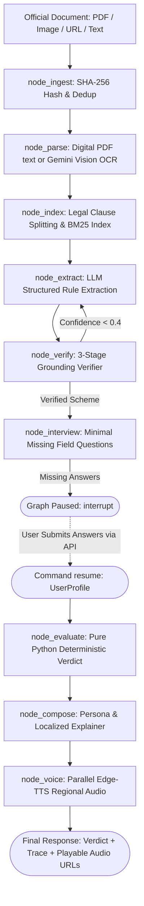

# CivicFlow: Complete Engineering Handover & Agent Guide

> **Welcome Agent!**  
> This document is the single source of truth for **CivicFlow**. Read this thoroughly before modifying or creating any code. It explains the entire architecture, strict design rules, everything built in Phases 1–7, runtime environment specifics, and complete specifications for building **Phase 8 (Frontend)** and **Phase 9 (Robustness)**.

---

## Table of Contents
1. [Project Mission & Non-Negotiable Rules](#1-project-mission--non-negotiable-rules)
2. [Complete Environment Setup & Prerequisites Guide](#2-complete-environment-setup--prerequisites-guide)
3. [Runtime Environment & Critical Quirks](#3-runtime-environment--critical-quirks)
4. [Deep-Dive Architecture & Data Contracts](#4-deep-dive-architecture--data-contracts)
5. [Phase-by-Phase Review (What Was Built)](#5-phase-by-phase-review-what-was-built)
6. [LangGraph State Machine & API Endpoints](#6-langgraph-state-machine--api-endpoints)
7. [Next Steps: Phase 8 (React Frontend Spec)](#7-next-steps-phase-8-react-frontend-spec)
8. [Phase 9: Robustness & Demo Checklist](#8-phase-9-robustness--demo-checklist)
9. [Commands & Verification Cheatsheet](#9-commands--verification-cheatsheet)

---

## 1. Project Mission & Non-Negotiable Rules

### The Mission
CivicFlow is an AI-powered civic intelligence platform that transforms convoluted legal documents (welfare policies, gazette notifications, municipal circulars) into:
1. **Deterministic Eligibility Verdicts (`YES` / `NO` / `MAYBE`)** calculated through pure Python (zero LLM evaluation).
2. **Clause-Level Grounded Citations**: Every fact is backed by a verbatim quote and stable clause ID.
3. **Regional Voice Explainers**: Segmented high-quality regional voice playback (Hindi, Marathi, Tamil, etc.) with actionable checklists (documents, deadlines, submission points).

### Non-Negotiable Project Rules (from `AGENTS.md`)
These rules take precedence over all general conventions. Violating them will break the system or risk hackathon disqualification:

1. **Strict Layering**: `routes` $\to$ `nodes` $\to$ `providers`.
   - **Never import external SDKs directly inside `app/nodes/` or `app/routes/`.**
   - Only `app/providers/` can import SDKs (`google-genai`, `edge-tts`, `httpx`).
2. **Deterministic Evaluation**:
   - `app/nodes/evaluate.py` is **100% pure Python**.
   - **NEVER call an LLM inside `evaluate.py`.** All mathematical comparisons, boundary logic, and unit conversions must be deterministic.
3. **Data Contracts Integrity**:
   - All shared schemas live in `app/schemas.py`. Never add, remove, or modify fields without explicit user instruction.
4. **Zero Mock / Dummy Data**:
   - **NEVER add hardcoded, mock, sample, or placeholder policy data to `app/`.**
   - Test fixtures belong strictly in `tests/`.
5. **Grounded Fact Extraction**:
   - Every extracted `Condition`, `Benefit`, and `Obligation` must include a valid `clause_id` and a verbatim `quote` from the source clause text.
6. **Structured LLM Outputs**:
   - All LLM outputs must be validated against a Pydantic schema with retry on failure (`generate_structured`).
7. **Externalized Prompts**:
   - Prompts live exclusively in `app/prompts/*.md`, never inline as string literals in Python modules.
8. **Typed Exceptions Only**:
   - No bare `except:` or generic `except Exception:`.
   - Raise typed exceptions defined in `app/exceptions.py` (`UnreadableDocument`, `ProviderError`, `NotAPolicy`).
9. **Git Policy**:
   - **NEVER execute `git commit` autonomously.** The user insists on committing code themselves. Always suggest commit messages instead.

---

## 2. Complete Environment Setup & Prerequisites Guide

If you are cloning this repository or setting up a fresh machine/environment, follow this step-by-step guide to replicate the exact working environment.

### 2.1 Prerequisites
1. **Python 3.11 or 3.12** (CivicFlow was built with Python `3.12.10`).
   - Check with: `python --version` (or `python3 --version`).
2. **Node.js 18+ & npm** (Required for Phase 8 Frontend - React/Vite).
   - Check with: `node --version` and `npm --version`.
3. **Google Gemini API Key**:
   - Get a free key from Google AI Studio: [https://aistudio.google.com/app/apikey](https://aistudio.google.com/app/apikey)
   - *(Note: Microsoft Edge-TTS does not need any key - it is free and works out of the box).*
4. **Git**:
   - Check with: `git --version`.

---

### 2.2 Step-by-Step Environment Setup

#### Step 1: Create and Activate Virtual Environment
Open a terminal in the project root (`CivicFlow`):

- **On Windows (PowerShell)**:
  ```powershell
  python -m venv .venv
  # Optional activation (or call .\.venv\Scripts\python directly):
  .\.venv\Scripts\Activate.ps1
  ```
  *(Note: If PowerShell throws an `Execution_Policies` restriction, run: `Set-ExecutionPolicy -Scope CurrentUser -ExecutionPolicy RemoteSigned` or simply invoke binaries directly via `.\.venv\Scripts\python` and `.\.venv\Scripts\pytest` without activating).*

- **On macOS / Linux**:
  ```bash
  python3 -m venv .venv
  source .venv/bin/activate
  ```

#### Step 2: Install All Dependencies
Upgrade pip and install CivicFlow in editable mode with development dependencies:

- **On Windows**:
  ```powershell
  .\.venv\Scripts\python -m pip install --upgrade pip
  .\.venv\Scripts\pip install -e ".[dev]"
  ```

- **On macOS / Linux**:
  ```bash
  pip install --upgrade pip
  pip install -e ".[dev]"
  ```

This installs:
- **Core Pipeline**: `fastapi`, `uvicorn[standard]`, `pydantic`, `pydantic-settings`, `httpx`, `python-multipart`, `langgraph`, `langchain-core`, `pypdf`, `rank-bm25`, `edge-tts`, `google-genai`
- **Testing**: `pytest`, `pytest-asyncio`

#### Step 3: Configure Environment Variables (`.env`)
Create your `.env` file by copying `.env.example`:

- **On Windows (PowerShell)**:
  ```powershell
  Copy-Item .env.example .env
  ```
- **On macOS / Linux**:
  ```bash
  cp .env.example .env
  ```

Open `.env` and paste your Gemini API key:
```env
# Mandatory LLM Provider Configuration
LLM_PROVIDER=groq
GROQ_API_KEY=your_groq_api_key_here
GROQ_MODEL_FAST=llama-3.1-8b-instant
GROQ_MODEL_STRONG=llama-3.3-70b-versatile

# Gemini Configuration (Fallback)
GEMINI_API_KEY=your_gemini_api_key_here
MODEL_FAST=gemini-3-flash-preview
MODEL_STRONG=gemini-3-flash-preview
LLM_TIMEOUT_SECONDS=30

# Application Settings
APP_ENV=development
HOST=0.0.0.0
PORT=8000
DEBUG=True

# Language & Localization
SUPPORTED_LANGUAGES=["hi", "en", "mr", "ta", "te", "bn"]
DEFAULT_LANGUAGE=hi

# Storage & Cache Directories
SQLITE_DB_PATH=civicflow_checkpoints.sqlite
AUDIO_OUTPUT_DIR=audio_cache
UPLOAD_DIR=uploads
```

> [!IMPORTANT]
> Verify that `MODEL_FAST` and `MODEL_STRONG` are set to `gemini-3-flash-preview`. Using deprecated models (`gemini-2.5-pro` or `gemini-2.5-flash`) will result in HTTP 404 errors from Google AI Studio.

---

### 2.3 Verification: Testing the Setup
Verify that your newly setup environment works 100% by running the two built-in test suites:

#### Check 1: Run Full Pytest Suite (55 passing tests)
- **Windows**: `.\.venv\Scripts\pytest -v`
- **macOS/Linux**: `pytest -v`
*Expected output*: `55 passed in ~10s`.

#### Check 2: Run End-to-End Interactive Verification
- **Windows**: `.\.venv\Scripts\python test_demo.py`
- **macOS/Linux**: `python test_demo.py`
*Expected output*: Executes all 5 core subsystems (BM25 search, self-correcting verifier, dynamic interview, Edge-TTS parallel voice synthesis, and LangGraph pause/resume) and prints:
```
=================================================================
ALL 5 INTERACTIVE CHECKS COMPLETED SUCCESSFULLY!
=================================================================
```

#### Check 3: Launch Local FastAPI Server
- **Windows**: `.\.venv\Scripts\uvicorn app.main:app --reload --port 8000`
- **macOS/Linux**: `uvicorn app.main:app --reload --port 8000`
Open browser at `http://127.0.0.1:8000/docs` to inspect interactive Swagger documentation.

---

## 3. Runtime Environment & Critical Quirks

Keep these operating system and library constraints in mind when writing or running code:

- **Operating System**: Windows (PowerShell).
  - *PowerShell Quoting*: Never write multi-line Python snippets via `python -c "..."` containing double quotes or line breaks. It causes syntax errors. Instead, create a script or run test files.
  - *Console Encoding*: When printing regional text (Hindi, Marathi, etc.) to stdout in Windows terminals, include:
    ```python
    import sys
    if sys.platform == "win32":
        sys.stdout.reconfigure(encoding="utf-8")
    ```
- **Python Virtual Environment**:
  - Located at: `.venv\` in the project root (`d:\Ayushh\Antigravity\CivicFlow\.venv\Scripts\python.exe`).
  - Run tests with: `.\.venv\Scripts\pytest -v`.
- **Gemini Model Configuration**:
  - Google recently deprecated `gemini-2.5-pro` and `gemini-2.5-flash` for new API keys.
  - The working active models are configured in `app/config.py` and `.env`:
    ```env
    MODEL_FAST=gemini-3-flash-preview
    MODEL_STRONG=gemini-3-flash-preview
    ```
  - Use `tier="fast"` or `tier="strong"` when calling `llm.generate_structured(...)`.
- **Speech Synthesis (Edge-TTS)**:
  - Free, fast, and does **not** require an API key.
  - Supported Indian languages: Hindi (`hi`), English (`en`), Marathi (`mr`), Tamil (`ta`), Telugu (`te`), Bengali (`bn`), Gujarati (`gu`), Kannada (`kn`), Malayalam (`ml`), Urdu (`ur`).
  - Generated files are saved to `audio_cache/` and served via FastAPI at `/audio/{filename}`.
- **SQLite Concurrency on Windows**:
  - `app/store.py` uses a connection-per-call pattern (`sqlite3.connect(...)` closed in `finally`) rather than a long-lived open connection to prevent `WinError 32: The process cannot access the file because it is being used by another process`.

---

## 4. Deep-Dive Architecture & Data Contracts

### High-Level Architectural Flow



### Core Schemas (`app/schemas.py`)

| Schema | Role & Key Fields |
|---|---|
| `Clause` | Atomic unit of legal text: `id` (e.g. `doc123-p1-c02`), `doc_id`, `page`, `text`. |
| `Cited` | Base class enforcing grounding: `clause_id: str`, `quote: str`. |
| `Condition` | Extracted eligibility rule: inherits `Cited`, `field: Field_`, `operator: Operator`, `value: Any`, `unit: Optional[str]`. |
| `Benefit` | Welfare grant/subsidy: inherits `Cited`, `description: str`, `amount: Optional[float]`, `frequency: Optional[str]`. |
| `Obligation` | Mandatory duties: inherits `Cited`, `description: str`, `deadline: Optional[str]`, `required_documents: list[str]`, `apply_at: Optional[str]`. |
| `Scheme` | Complete structured policy: `doc_id`, `title`, `audience`, `conditions`, `benefits`, `obligations`, `uncertain`, `confidence`. |
| `InterviewQuestion` | Targeted user query: `field: Field_`, `question_text: str`, `input_type: str`, `choices: list[str]`. |
| `UserProfile` | User's submitted profile answers: `answers: dict[Field_, Any]`. |
| `Verdict` | Deterministic decision: `status: VerdictStatus` (`YES`, `NO`, `MAYBE`), `reasons: list[Reason]`, `missing_fields: list[Field_]`, `summary: str`. |
| `Segment` | Individual voice explainer chunk: `text: str`, `clause_ids: list[str]`, `audio_url: Optional[str]`. |
| `Explainer` | Complete output package: `language: str`, `segments: list[Segment]`, `checklist: list[str]`, `audio_urls: list[str]`. |

---

## 5. Phase-by-Phase Review (What Was Built)

### Phase 1: Skeleton & Contracts ✅
- **`app/schemas.py`**: Pydantic v2 schemas defining every data structure across the system.
- **`app/config.py`**: Environment variables managed via Pydantic `BaseSettings`.
- **`app/main.py`**: Initial FastAPI setup with `/health` endpoint.
- **Tests**: `test_schemas.py`, `test_health.py`.

### Phase 2: Provider Abstraction Layer ✅
- **`app/exceptions.py`**: Custom typed exceptions (`CivicFlowError`, `UnreadableDocument`, `ProviderError`, `NotAPolicy`).
- **`app/providers/base.py`**: Abstract protocols for `LLM` and `TTS`.
- **`app/providers/llm.py`**: `GeminiLLMProvider` using Google GenAI SDK with structured output (`GenerateContentConfig`), multimodal OCR capability (`Part.from_bytes`), and automatic self-correcting retry loop.
- **`app/providers/speech.py`**: `EdgeTTSProvider` supporting 10 Indian regional languages asynchronously.
- **Tests**: `test_llm_provider.py`, `test_speech.py`.

### Phase 3: Ingest, Parse & Index ✅
- **`app/providers/sources.py`**: Official document fetcher with verified repository URLs (`India Code`, `e-Gazette`, `myScheme`, `PIB`).
- **`app/store.py`**: SQLite storage for document metadata and clause caching.
- **`app/nodes/ingest.py`**: Ingests files or URLs, computes SHA-256 hashes, checks cache.
- **`app/nodes/parse.py`**: Smart parser: digital PDF text (`pypdf`) $\to$ scanned PDF OCR (`gemini-3-flash-preview`) $\to$ direct image OCR.
- **`app/nodes/index.py`**: Splits legal documents by section headers and numbered clauses, assigns deterministic stable IDs (`{doc_id[:6]}-p{page}-c{idx}`), and builds in-memory BM25 index.
- **`app/prompts/ocr.md`**: Prompt for transcription of low-quality gazette scans.
- **Tests**: `test_ingest.py`, `test_parse.py`, `test_index.py`, `test_store.py`, `test_sources.py`.

### Phase 4: Extraction & Self-Correcting Verifier ✅
- **`app/nodes/extract.py`**: Concurrently extracts conditions, benefits, and obligations from clause clusters using controlled vocabularies (`Field_`, `Operator`).
- **`app/nodes/verify.py`**: 3-stage verification:
  1. *Normalized Substring Match*: Checks if `quote` exists in the clause.
  2. *Indian Number Normalization*: Handles `1.5 lakh` ($150,000$), `2 crore` ($20,000,000$), `₹ 6,000/-`, and commas (`1,50,000`).
  3. *LLM Fallback Verifier*: Verifies nuanced paraphrasing or returns `is_supported=False`.
  - Corrupted or unverified claims are stripped and safely relocated to `scheme.uncertain`.
- **`app/prompts/extract.md`** & **`app/prompts/verify.md`**.
- **Tests**: `test_extract.py`, `test_verify.py`.

### Phase 5: Dynamic Interview & Deterministic Engine ✅
- **`app/nodes/interview.py`**: Generates targeted questions **only** for fields required by the document's conditions that are not yet answered in the user's profile. Includes regional prompt translations and robust input validator for Indian number formats and booleans.
- **`app/nodes/evaluate.py`**: Pure Python rule evaluation engine.
  - Supports all 8 operators (`lt`, `lte`, `gt`, `gte`, `eq`, `neq`, `in`, `not_in`).
  - Unit conversions: `acres` $\to$ `hectares` ($1\text{ acre} \approx 0.404686\text{ ha}$), `lakh` / `crore` $\to$ `INR`.
  - Returns `Verdict` (`YES` if all pass, `NO` if any fail, `MAYBE` if fields are missing or clauses are ambiguous).
- **Tests**: `test_interview.py`, `test_evaluate.py`.

### Phase 6: Localize, Compose & Voice ✅
- **`app/nodes/compose.py`**: Generates persona-tailored explainers (Citizen = benefit-first; Business = compliance-first) with sentence-level clause citations and action checklists.
- **`app/nodes/localize.py`**: Indian legal glossary for Hindi, Marathi, and English.
- **`app/nodes/voice.py`**: Synthesizes speech for each segment in parallel via `asyncio.gather()`, outputs audio to `audio_cache/`, and binds relative URLs (`/audio/{filename}`).
- **`app/prompts/compose.md`**.
- **Tests**: `test_compose.py`, `test_localize.py`, `test_voice_node.py`.

### Phase 7: LangGraph State Graph & Streaming API ✅
- **`app/graph.py`**: Full LangGraph state machine orchestrating all 9 nodes with conditional routing, retry loops, and `interrupt()` human-in-the-loop pause.
- **`app/routes/pipeline.py`**:
  - `POST /pipeline/start`: Multipart file or official URL upload.
  - `GET /pipeline/{run_id}/events`: Server-Sent Events (SSE) streaming real-time node transitions.
  - `GET /pipeline/{run_id}/status`: Snapshot of graph state, missing interview questions, and final verdict.
- **`app/routes/session.py`**:
  - `POST /session/{run_id}/answers`: Resumes the paused state machine using `Command(resume=answers_dict)`.
- **`app/main.py`**: Mounts routers, static audio directory (`/audio`), and global typed exception handlers.
- **Tests**: `test_api_pipeline.py` (complete end-to-end integration test).

---

## 6. LangGraph State Machine & API Endpoints

### State Machine Nodes & Graph Edges

```python
builder.add_node("ingest", node_ingest)
builder.add_node("parse", node_parse)
builder.add_node("index", node_index)
builder.add_node("extract", node_extract)
builder.add_node("verify", node_verify)
builder.add_node("interview", node_interview)    # Pauses via interrupt() if answers needed
builder.add_node("evaluate", node_evaluate)      # Pure Python evaluation
builder.add_node("compose", node_compose)        # Localized plain-language summary
builder.add_node("voice", node_voice)            # Parallel TTS generation
```

- **Conditional Edge (`parse` $\to$ `index` or `END`)**: Aborts immediately if the document cannot be parsed or OCR fails.
- **Conditional Edge (`verify` $\to$ `extract` or `interview` or `END`)**: If verification confidence $< 0.4$ and retries $< 2$, loops back to `extract` to re-extract with fresh parsing.

### How Interrupt & Resume Work
1. When `node_interview` executes, if there are conditions whose fields are not in `profile.answers`, it calls:
   ```python
   user_submission = interrupt({
       "type": "interview_required",
       "questions": [q.model_dump() for q in questions],
   })
   ```
   This suspends graph execution and saves state in `MemorySaver`.
2. When the user submits answers via `POST /session/{run_id}/answers`:
   ```python
   result = await pipeline_graph.ainvoke(
       Command(resume=payload.model_dump()),
       config={"configurable": {"thread_id": run_id}}
   )
   ```
   The graph resumes inside `node_interview`, updates `profile.answers`, and runs through `evaluate` $\to$ `compose` $\to$ `voice` $\to$ `END`.

### REST API Reference

| Method | Endpoint | Description | Request / Query Params |
|---|---|---|---|
| `GET` | `/health` | Healthcheck | None |
| `GET` | `/sources/verified` | Pre-verified official policy repository URLs | None |
| `POST` | `/pipeline/start` | Start document pipeline | Multipart: `file`, `url`, `persona` (`citizen`/`business`), `language` (`hi`/`en`/`mr`/`ta`...) |
| `GET` | `/pipeline/{run_id}/events` | Real-time SSE event stream | Header: `Accept: text/event-stream` |
| `GET` | `/pipeline/{run_id}/status` | Get current state snapshot | Path: `run_id` |
| `POST` | `/session/{run_id}/answers` | Resume graph with interview answers | JSON: `{"answers": {"land_hectares": 1.5}, "units": {"land_hectares": "hectares"}}` |
| `GET` | `/audio/{filename}` | Stream synthesized audio | Path: `filename` (e.g. `demo_kisan_seg_00.mp3`) |

---

## 7. Next Steps: Phase 8 (React Frontend Spec)

The backend is fully verified and stable. The next critical deliverable is **Phase 8: Frontend**.

### Recommended Frontend Stack
- **Framework**: Vite + React + TypeScript
- **Styling**: Tailwind CSS
- **Icons**: Lucide React (`lucide-react`)
- **HTTP/SSE**: Native `fetch` / `EventSource`
- **Location**: `frontend/` directory in project root.

### The 7 Core Screens & Components to Build

#### 1. Ingestion & Configuration Bar
- Drag-and-drop file upload zone (supports `.pdf`, `.png`, `.jpg`, `.txt`).
- Alternate "Or paste official policy URL" input field with quick-select pills from `/sources/verified`.
- Persona Toggle: `Citizen` (Benefit-First) vs `Small Business` (Compliance-First).
- Language Selector: Hindi (default), English, Marathi, Tamil, Telugu, Bengali.

#### 2. Live SSE Progress Panel
- Connects to `GET /pipeline/{run_id}/events`.
- Visual step tracker showing node ticks:
  `Ingesting` $\to$ `Parsing & OCR` $\to$ `Indexing Clauses` $\to$ `Extracting Rules` $\to$ `Self-Correcting Verification` $\to$ `Interview` $\to$ `Evaluation` $\to$ `Explainer & Voice`.
- Displays real-time latency in milliseconds and retry alerts if the verifier loops.

#### 3. Clause Review & Verification Inspector
- Side-by-side or collapsible drawer showing:
  - Extracted **Conditions**, **Benefits**, and **Obligations**.
  - Confidence meter (e.g. `95% Grounded`).
  - Flagged/Uncertain claims accordion with explanation of why they were flagged.
  - Tapping on any condition highlights the original clause text and verbatim quote.

#### 4. Dynamic Interview Card (Human-in-the-Loop)
- When SSE emits `interview_required` (or status is `waiting_for_answers`):
  - Renders a clean card containing **only** the missing questions.
  - Displays questions in the user's chosen language (e.g., Hindi prompt).
  - Handles unit inputs smoothly (e.g., dropdown for `acres` vs `hectares`, `lakh` vs `INR`).
  - Submits answers to `POST /session/{run_id}/answers` to resume the pipeline.

#### 5. Verdict Card (The "Headline" Result)
- Prominent badge:
  - **`YES` (Green)**: "You qualify!"
  - **`NO` (Red)**: "You do not qualify."
  - **`MAYBE` (Amber)**: "Pending review / Ambiguous clauses."
- Summary sentence in the chosen language.
- Breakdown of every condition evaluated:
  - e.g., *"Your landholding of 1.2 ha $\le 2.0$ ha $\to$ PASSED (Clause doc-p1-c02)"*.

#### 6. Segmented Voice Player & Synchronized Transcript
- Audio player for the multi-segment explainer.
- As an audio segment plays (`/audio/{filename}`), automatically highlight the corresponding sentence in the regional transcript.
- Clicking any segment jumps audio playback to that segment and reveals the cited legal clause.

#### 7. Action Checklist
- Printable / actionable bulleted list:
  - **Required Documents** (e.g., Aadhaar Card, Land Revenue Records).
  - **Submission Point** (e.g., Nearest Common Service Centre (CSC) or online portal).
  - **Deadlines** (e.g., 31 March 2026).

---

## 8. Phase 9: Robustness & Demo Checklist

Before presenting the live demo, run through this edge-case checklist:

- [ ] **Blurry / Rotated Document**: Upload a blurry photo or upside-down page. Ensure the frontend shows a friendly `UnreadableDocument` error with a "Retake clearer photo" suggestion.
- [ ] **Non-Policy Document**: Upload an irrelevant receipt or invoice. Ensure the system safely raises `NotAPolicy` without crashing.
- [ ] **Scanned PDF with No Text**: Ensure the Gemini Vision OCR path triggers smoothly and extracts clauses.
- [ ] **Contradictory / Unclear Clauses**: Verify that conflicting conditions safely downgrade the verdict to `MAYBE` with notes in `uncertain`.
- [ ] **Indian Input Formats**: Test entering comma-separated numbers (`1,50,000`), Indian shorthand (`1.5 lakh`), or regional affirmative answers (`हाँ`, `Yes`).
- [ ] **Concurrent Runs**: Test starting two pipeline runs in separate browser tabs to ensure state graphs do not collide (each run uses an isolated `thread_id` and SSE queue).

---

## 9. Commands & Verification Cheatsheet

### 1. Run Automated Test Suite (55 tests)
```powershell
.\.venv\Scripts\pytest -v
```

### 2. Run Interactive CLI Self-Test (5 Subsystems)
```powershell
.\.venv\Scripts\python test_demo.py
```

### 3. Start Backend Server
```powershell
.\.venv\Scripts\uvicorn app.main:app --reload --port 8000
```
Swagger UI available at: `http://127.0.0.1:8000/docs`

---
*Created for CivicFlow by Antigravity Agent. All backend systems are fully validated and ready for frontend integration.*

