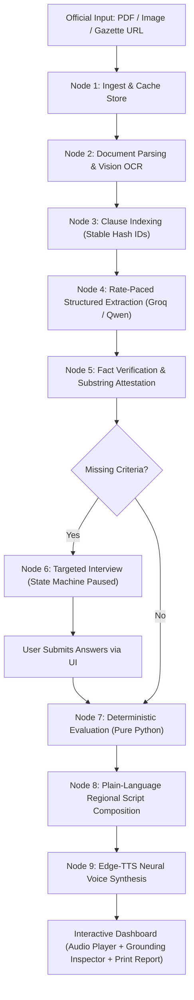

# CivicFlow 🏛️🇮🇳
### Multilingual Policy, Rights & Scheme Explainer

> **An intelligent civic-tech engine that ingests government gazette notifications, welfare policy guidelines, or municipal acts and converts them into plain, regional-language voice explainers highlighting exact rights, deterministic eligibility, and actionable citizen steps.**

---

## 🌟 The Problem
Every year, billions of rupees in government welfare schemes lapse because policies are written in dense, bureaucratic legalese across 20+ page PDFs. Citizens and small business owners cannot determine:
1. **Whether they actually qualify** (due to obscure exclusion clauses and land/income ceilings).
2. **What their exact rights and benefits are** (cash amounts, frequencies, subsidies).
3. **What concrete actions are required** (deadlines, portal submissions, documents).

## 💡 The Solution: CivicFlow
CivicFlow bridges the civic information divide with zero hallucination:
- **100% Verbatim Grounding**: Every extracted condition, benefit, and obligation cites its exact `clause_id` and verbatim quote from the original gazette.
- **Pure-Python Deterministic Evaluation**: Eligibility decisions are computed using pure mathematical logic and boolean trees in Python. **No LLM ever decides citizen eligibility.**
- **Adaptive Human-in-the-Loop Interview**: If a citizen's profile is missing an eligibility field (e.g. land size, annual income), the state machine pauses and asks only the missing criteria.
- **Regional Neural Voice Explainers**: Synthesizes spoken audio in **Hindi (हिन्दी), Marathi (मराठी), Tamil, Telugu, Bengali, and English** using Edge-TTS high-definition neural voices.
- **Actionable Checklist & Printable Report**: Auto-generates exact submission channels, deadline notices, and official printable verification sheets.

---

## 🏗️ System Architecture & Workflow

CivicFlow uses a deterministic **LangGraph State Machine** with checkpointed execution and SSE streaming:



---

## 💻 Tech Stack

| Layer | Technologies |
|---|---|
| **Backend Framework** | Python 3.11+, FastAPI, Uvicorn, Pydantic V2, Pydantic-Settings |
| **Pipeline & State Machine** | LangGraph, LangChain Core, SQLite Checkpointer |
| **Inference & LLM** | Groq LPU (`qwen/qwen3.8-27b`, `openai/gpt-oss-120b`), Google Gemini fallback |
| **Document Processing** | PyPDF, Rank-BM25, Custom Quality Gates |
| **Audio & Speech** | Microsoft Edge-TTS Neural Voice Engine |
| **Frontend UI** | React 18, TypeScript, Vite, Tailwind CSS, Lucide React Icons |
| **Deployment** | Docker (Multi-stage build), Docker Compose, Render.com, Railway |

---

## 📂 Project Structure

```
CivicFlow/
├── app/
│   ├── main.py                  # FastAPI entry point & unified static mounting
│   ├── config.py                # Environment configuration via Pydantic
│   ├── exceptions.py            # Typed domain errors (UnreadableDocument, NotAPolicy)
│   ├── graph.py                 # LangGraph pipeline state machine & routing
│   ├── schemas.py               # Immutable Pydantic data contracts
│   ├── store.py                 # SQLite document & clause persistence
│   ├── nodes/
│   │   ├── ingest.py            # Document ingestion & SHA-256 caching
│   │   ├── parse.py             # PDF text extraction & Vision OCR quality gates
│   │   ├── index.py             # Clause segmenter with stable IDs
│   │   ├── extract.py           # Paced multi-section rule extraction
│   │   ├── verify.py            # 3-stage quote & number verification
│   │   ├── interview.py         # Dynamic targeted interview generator
│   │   ├── evaluate.py          # Deterministic Python rule evaluation
│   │   ├── compose.py           # Regional plain-language explainer composer
│   │   └── voice.py             # Edge-TTS audio synthesizer
│   ├── prompts/                 # External prompt templates (extract, compose, ocr, verify)
│   ├── providers/               # Modular LLM (Groq, Gemini), TTS, & source adapters
│   └── routes/                  # API endpoints (pipeline, session, sources)
├── frontend/
│   ├── src/
│   │   ├── App.tsx              # Main application dashboard
│   │   ├── api.ts               # REST & SSE communication layer
│   │   ├── types.ts             # TypeScript interfaces mirroring schemas.py
│   │   └── components/          # Reusable UI widgets
│   │       ├── ExtractionProgressCard.tsx  # Live rate-limit countdown loader
│   │       ├── GroundingInspector.tsx      # Clause quote citation drawer
│   │       ├── VerdictCard.tsx             # Qualified / Disqualified banner
│   │       ├── InterviewCard.tsx           # Human-in-the-loop dynamic form
│   │       ├── VoicePlayer.tsx             # Synchronized regional audio player
│   │       ├── ActionChecklist.tsx         # Submission points & document list
│   │       └── SchemePrintReport.tsx       # Printable official verification report
│   ├── package.json
│   └── vite.config.ts
├── tests/                       # Complete unit & integration test suite
├── Dockerfile                   # Multi-stage production container build
├── docker-compose.yml           # 1-command container deployment
├── render.yaml                  # Blueprint for 1-click Render deployment
├── requirements.txt             # Pinned Python dependencies
└── DEPLOYMENT.md                # Cloud deployment walkthrough
```

---

## 🚀 Quickstart & Local Installation

### Prerequisites
- **Python 3.11+** installed
- **Node.js 18+** & `npm` installed
- Free **Groq API Key** from [console.groq.com/keys](https://console.groq.com/keys)

---

### 1. Clone & Configure
```bash
git clone https://github.com/<your-username>/CivicFlow.git
cd CivicFlow

# Create your .env file
cp .env.example .env
```

Open `.env` and configure your API key:
```ini
LLM_PROVIDER=groq
GROQ_API_KEY=gsk_your_actual_key_here
GROQ_MODEL_FAST=qwen/qwen3.8-27b
GROQ_MODEL_STRONG=openai/gpt-oss-120b
```

---

### 2. Backend Setup
```bash
# Create and activate virtual environment
python -m venv .venv

# On Windows:
.\.venv\Scripts\activate
# On Linux/macOS:
# source .venv/bin/activate

# Install backend dependencies
pip install -r requirements.txt
```

Start the FastAPI backend:
```bash
uvicorn app.main:app --reload --port 8000
```
*Backend API Docs will be live at: `http://localhost:8000/docs`*

---

### 3. Frontend Setup
In a new terminal window:
```bash
cd frontend
npm install
npm run dev
```
*Frontend UI will be live at: `http://localhost:5173`*

---

## 🐳 Docker Deployment (1-Command All-in-One)

You can run both the Frontend and Backend unified in a single container:

```bash
docker compose up -d --build
```
Access the application at `http://localhost:8000`.

---

## ☁️ Cloud Deployment (Render / Railway)

CivicFlow is pre-configured for **1-click cloud deployment**:
1. Push your code to GitHub.
2. In **Render.com** (or **Railway.app**), create a **New Web Service** pointing to your repository.
3. Select **Docker** environment.
4. Add your `GROQ_API_KEY` under Environment Variables.
5. Deploy! Both the React UI and FastAPI API will be served together on your public URL.

*(See [DEPLOYMENT.md](file:///d:/Ayushh/Antigravity/CivicFlow/DEPLOYMENT.md) for full cloud hosting details).*

---

## 🛡️ Key Project Guarantees
- **Never Hallucinates Eligibility**: Evaluated strictly through boolean AST logic in pure Python (`app/nodes/evaluate.py`).
- **Verbatim Legal Citations**: Every asserted condition or benefit links to a specific clause and verbatim sentence in the gazette.
- **Graceful Error Handling**: Detects blurry photos (`UnreadableDocument`), non-policy documents (`NotAPolicy`), and provider rate-limits with contextual hints.
- **Language Inclusivity**: Real-time regional voice explainers allow non-literate or regional-language citizens to hear their exact rights spoken clearly.

---

## 📜 License
MIT License. Built with ❤️ for civic empowerment and inclusive public welfare governance.

